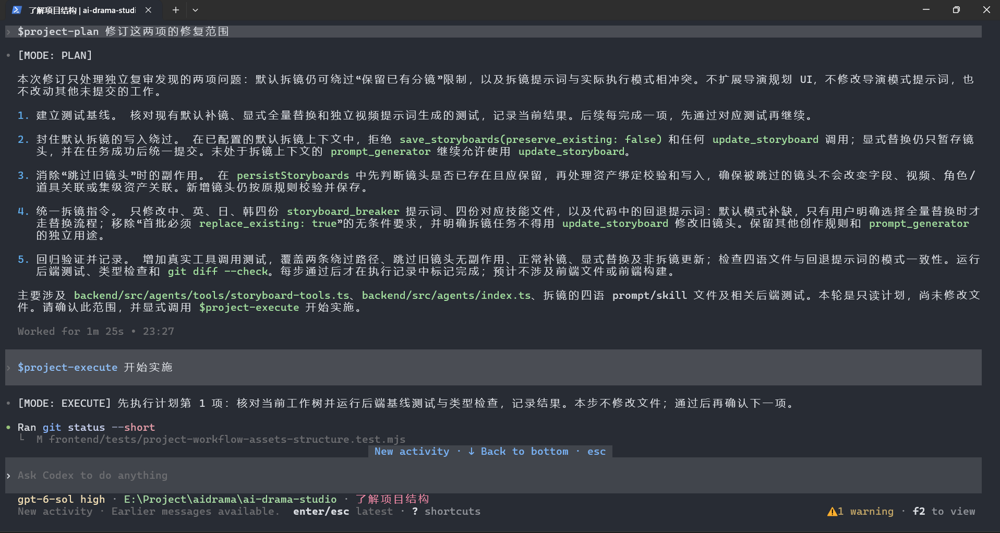
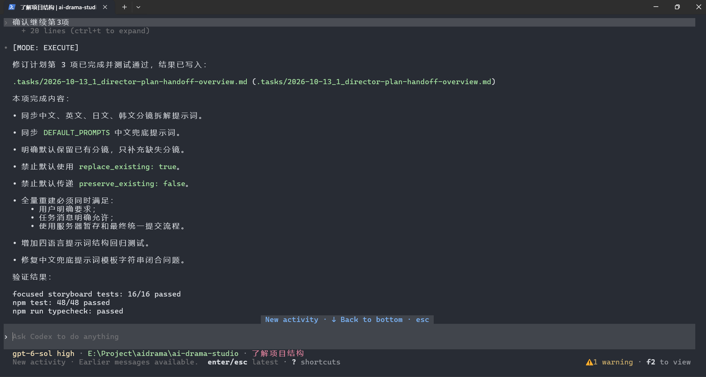

<p align="center">
  
</p>

<h1 align="center">Lumosylva Skills</h1>

<p align="center">
  <a href="https://github.com/Lumosylva/lumosylva-skills/releases/latest"></a>
  <a href="LICENSE"></a>
  <a href="https://www.npmjs.com/"></a>
  <a href="https://www.skills.sh/lumosylva/lumosylva-skills"></a>
</p>

<p align="center"><a href="README.md">English</a> | <a href="README.zh-CN.md">简体中文</a></p>

A collection of Agent Skills for structured software development workflows. Install them with the `skills` CLI.

## Design Philosophy

Lumosylva Skills separates investigation, exploration, planning, implementation, and review. Each mode has its own scope and authorization rules. Installing a skill does not activate it or override the agent's existing instructions and permissions.

## Skills

The repository follows the `skills/<skill-name>/SKILL.md` layout:

| Skill | Purpose |
|-------|---------|
| [general-spec](skills/general-spec/SKILL.md) | Optional workflow reference and task-file template |
| [project-research](skills/project-research/SKILL.md) | Investigate a codebase |
| [project-innovate](skills/project-innovate/SKILL.md) | Explore possible approaches |
| [project-plan](skills/project-plan/SKILL.md) | Specify an implementation plan |
| [project-execute](skills/project-execute/SKILL.md) | Implement the approved plan |
| [project-review](skills/project-review/SKILL.md) | Verify the implementation |

Each mode skill is self-contained. Install `general-spec` if you also want an overview and optional task-file template.

## Workflow Overview

```
Research -> Innovate -> Plan -> Execute -> Review
                          ^        |
                          +-- issue (request project-plan)
```

Explicitly invoke the skill for the stage you need. No mode is automatically active at the start of a new session, and completion or failure does not switch modes on its own.

## Five Collaborative Modes

| Mode | Skill | Purpose | Core Capabilities |
|------|---------|---------|-------------------|
| Research | `project-research` | Understand the task and codebase | Read files and report constraints; no worktree changes by default |
| Innovate | `project-innovate` | Compare approaches | Explore options and tradeoffs without implementation |
| Plan | `project-plan` | Specify an implementation | Produce a checklist for user approval; no code changes |
| Execute | `project-execute` | Implement an approved plan | Follow authorized steps and verify results |
| Review | `project-review` | Assess the implementation | Report deviations and risks; no commits or fixes by default |

## Usage Examples

The plan is presented for approval before implementation. After approval, execute follows the agreed scope and reports verification results.

<p align="center">
  
</p>
<p align="center"><em>Plan the work and confirm its scope before implementation.</em></p>

<p align="center">
  
</p>
<p align="center"><em>Execute the approved plan and report completed work and test results.</em></p>

## Installation

```bash
npx skills add Lumosylva/lumosylva-skills
```

The CLI may detect your agent or prompt for a target. Select the skills you need; each mode works independently. To list them without installing:

```bash
npx skills add Lumosylva/lumosylva-skills --list
```

## Using The Modes

Explicitly request a skill by name using your agent's skill interface or a prompt such as "Use project-research to investigate this issue." Some agents expose `/project-research`-style shortcuts; availability depends on the agent. A "yes" to a plan is approval, not an instruction to activate `project-execute`: request that skill separately when ready.

While a mode is active, replies start with `[MODE: RESEARCH]`, `[MODE: INNOVATE]`, `[MODE: PLAN]`, `[MODE: EXECUTE]`, or `[MODE: REVIEW]` and otherwise follow the user's language. Research, innovate, plan, and review are read-only by default. Task files, branches, commits, and pushes require separate authorization. Execute additionally requires an approved plan; changes outside it require revised approval.

The optional `general-spec` skill includes a task-file template. It does not automatically load or activate the mode skills.

### Step Confirmations

`YOLO_MODE` affects only per-step confirmation *after* the user has approved an execute plan. It does not authorize extra changes or destructive actions.

- **Off** (default): Confirm each significant implementation step.
- **Ask**: Confirm every implementation step.
- **On**: Continue through approved steps without per-step confirmation.

## Contributing

Issues and pull requests are welcome.

## License

MIT License - see [LICENSE](LICENSE)
