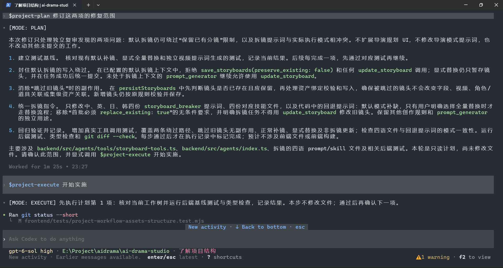
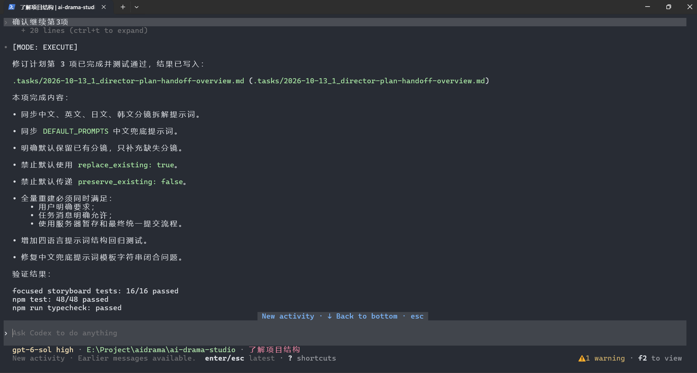

<p align="center">
  
</p>

<h1 align="center">Lumosylva Skills</h1>

<p align="center">
  <a href="https://github.com/Lumosylva/lumosylva-skills/releases/latest"></a>
  <a href="LICENSE"></a>
  <a href="https://www.skills.sh/lumosylva/lumosylva-skills"></a>
</p>

<p align="center"><a href="README.md">English</a> | <a href="README.zh-CN.md">简体中文</a></p>

一组用于规范化软件开发流程的 Agent Skills，可通过 `skills` CLI 安装。

## 设计理念

Lumosylva Skills 将调研、方案探索、规划、实施和审查分为不同模式。每种模式分别规定职责和授权范围。安装技能不会自动启用模式，也不会覆盖 Agent 原有的指令和权限。

## 技能列表

仓库采用 `skills/<skill-name>/SKILL.md` 结构：

| 技能 | 用途 |
|------|------|
| [general-spec](skills/general-spec/SKILL.md) | 可选的流程说明与任务文件模板 |
| [project-research](skills/project-research/SKILL.md) | 调研代码库 |
| [project-innovate](skills/project-innovate/SKILL.md) | 探索可选方案 |
| [project-plan](skills/project-plan/SKILL.md) | 制定实施计划 |
| [project-execute](skills/project-execute/SKILL.md) | 执行已批准的计划 |
| [project-review](skills/project-review/SKILL.md) | 核查实施结果 |

每个模式技能都可独立使用。如需流程概览与可选的任务文件模板，再安装 `general-spec`。

## 工作流程

```
调研 -> 构思 -> 规划 -> 执行 -> 审查
                ^        |
                +-- 发现问题（请求 project-plan）
```

需要哪个阶段，就明确调用对应技能。新会话不会自动进入任何模式；完成任务或遇到失败也不会自动切换模式。

## 五种协作模式

| 模式 | 技能 | 目标 | 主要工作 |
|------|------|------|----------|
| 调研 | `project-research` | 理解任务和代码库 | 阅读文件、报告约束；默认不改动工作区 |
| 构思 | `project-innovate` | 比较可选方案 | 探索方案与取舍，不实施修改 |
| 规划 | `project-plan` | 制定实施方案 | 编写待用户批准的清单，不修改代码 |
| 执行 | `project-execute` | 实施已批准的计划 | 按授权步骤修改并验证结果 |
| 审查 | `project-review` | 核查实施结果 | 报告偏差与风险，默认不修复或提交 |

## 使用示例

实施前先提交计划供用户确认；计划获批后，再按约定范围执行并汇报验证结果。

<p align="center">
  
</p>
<p align="center"><em>先制定计划并确认实施范围。</em></p>

<p align="center">
  
</p>
<p align="center"><em>执行已批准的计划，并汇报完成内容与测试结果。</em></p>

## 安装

```bash
npx skills add Lumosylva/lumosylva-skills
```

CLI 可能自动识别 Agent，也可能提示选择目标。选择所需技能即可；每个模式都可独立使用。如需只查看可用技能而不安装：

```bash
npx skills add Lumosylva/lumosylva-skills --list
```

## 使用模式

请通过 Agent 的技能界面，或使用“请用 project-research 调研这个问题”之类的提示明确调用技能。有些 Agent 支持 `/project-research` 等快捷指令，具体取决于客户端。回答“同意”只表示批准计划，不会自动启用 `project-execute`；准备实施时请另行调用该技能。

模式生效期间，回复以 `[MODE: RESEARCH]`、`[MODE: INNOVATE]`、`[MODE: PLAN]`、`[MODE: EXECUTE]` 或 `[MODE: REVIEW]` 开头，其余内容遵循用户使用的语言。调研、构思、规划和审查默认只读。创建分支、提交和推送需另行授权。执行必须有已批准的计划，并由用户明确调用 `project-execute`；该调用授权将批准的计划和执行进度记录到 `.tasks/`。超出批准计划的改动需要重新批准。

可选的 `general-spec` 技能提供流程概览和可复用的任务记录模板。用户明确调用 Execute 执行已批准计划后，计划记录会自动保存；其他模式的任务文件仍为可选，除非用户另行提出要求。安装 `general-spec` 不会自动加载或启用各模式技能。

如果已呈现最终计划，用户明确调用 `project-execute` 默认视为批准该计划，除非用户拒绝或要求修改。单独回复“同意”不会启用 Execute。

### Execute 任务记录

Execute 会优先将当前目录所属 Git worktree 根目录作为 `.tasks/` 位置；若当前目录不在 Git worktree，则使用客户端提供的唯一项目/工作区根目录。存在多个且无法判断时会询问用户；没有可用根目录时使用当前工作目录。若 `.tasks/` 不存在则自动创建，并将计划、执行清单、适用的接口和数据约定、验证项及进度保存到 `YYYY-MM-DD_plan-xxx.md` 文件。文件以独占且不覆盖的方式创建；若名称冲突则更换后缀重试。工具不支持安全的独占创建时会停止并记录阻塞原因。

### 步骤确认

`YOLO_MODE` 只控制已批准执行计划中的确认方式。它是本次 `project-execute` 调用的对话约定，不是操作系统环境变量或会自动持久化的客户端设置。调用 `project-execute` 时可指定 `YOLO_MODE=Ask` 或 `YOLO_MODE=On`；未指定时默认为 `Off`。

- **Off**（默认）：每个顶层计划清单项开始前询问并等待批准；一次批准覆盖该项中已列明的相关变更。
- **Ask**：每个可独立审查的变更组开始前询问并等待批准。一个变更组包含交付并验证同一计划结果所需的全部改动，包括跨文件的实现、直接相关测试和文档。仅当各部分有独立验收标准，且可单独交付或回退时才拆分；不按文件、代码行或工具调用拆分。计划中已授权的只读检查和验证无需额外逐步确认。
- **On**：在已批准计划范围内连续执行，不进行中间确认。

这些是面向模型的流程指令，并非强制执行机制；它们不会扩大已批准范围，也不会绕过客户端或工具权限及其他单独授权要求。

## 参与贡献

欢迎提交 Issue 和 Pull Request。

## 许可证

MIT 许可证，详见 [LICENSE](LICENSE)。
